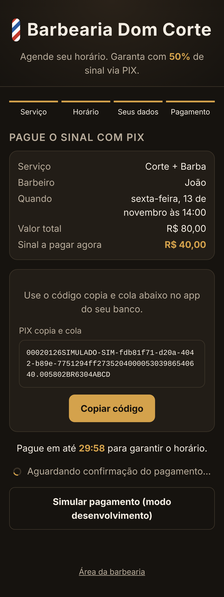
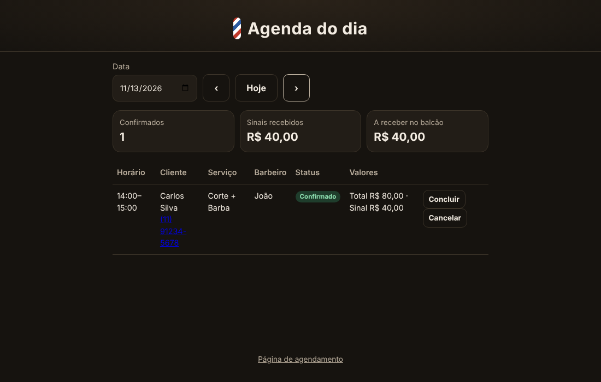

# Barbearia: agendamento com sinal de 50% via PIX

Site responsivo (funciona como app no celular, com opção "Adicionar à tela inicial") onde o cliente:

1. escolhe o **serviço** e o **barbeiro**;
2. escolhe o **dia** e um **horário livre**;
3. informa nome, telefone e e-mail;
4. **paga 50% do valor via PIX** para garantir a reserva. O restante é pago na barbearia.

O horário fica **segurado por 30 minutos** aguardando o PIX. Se o pagamento não chegar nesse prazo, a reserva
expira e o horário volta a ficar disponível. A confirmação aparece sozinha na tela assim que o PIX é pago.

A barbearia tem um painel (`/admin.html`) com a agenda do dia, os sinais recebidos, o valor a receber no
balcão, link direto para o WhatsApp do cliente e botões para concluir ou cancelar atendimentos.

| Serviço | Horário | Pagamento PIX | Confirmado |
|---|---|---|---|
|  |  |  |  |



## Tecnologias

Java 21 · Spring Boot 3.5 · Spring Data JPA · Flyway · PostgreSQL (H2 em desenvolvimento) · Spring Security ·
HTML/CSS/JS puro (sem build de front-end) · Mercado Pago (PIX)

```
src/main/java/br/com/barbearia
├── domain/                 Agendamento, Servico, Barbeiro, PoliticaDeSinal (regra dos 50%)
├── application/            AgendamentoService (regras), porta GatewayPagamento, repositórios
├── adapters/
│   ├── web/                API REST, webhook do Mercado Pago, painel admin
│   └── payment/            MercadoPagoGateway (real) e SimuladorGateway (desenvolvimento)
└── config/                 Segurança e relógio (fuso America/Sao_Paulo)
```

## Rodando localmente

```bash
cd barbearia
mvn spring-boot:run
```

Abra http://localhost:8080. Em desenvolvimento o pagamento é **simulado**: na tela do PIX aparece o botão
"Simular pagamento". Painel: http://localhost:8080/admin.html (usuário `admin`, senha `admin`).

Testes: `mvn test`.

## Colocando em produção com Mercado Pago

1. Crie uma aplicação em https://www.mercadopago.com.br/developers/panel e copie o **Access Token**
   (use o de teste `TEST-...` primeiro, depois o de produção `APP_USR-...`). A conta precisa ter uma
   **chave PIX cadastrada**.
2. Em *Webhooks*, cadastre a URL `https://SEU-DOMINIO/api/pagamentos/webhook/mercadopago` com o evento
   **Pagamentos** e copie a **assinatura secreta**.
3. Suba a aplicação com as variáveis:

| Variável | Exemplo |
|---|---|
| `PAGAMENTO_PROVEDOR` | `mercadopago` |
| `MERCADOPAGO_ACCESS_TOKEN` | `APP_USR-...` |
| `MERCADOPAGO_WEBHOOK_SECRET` | assinatura secreta do webhook |
| `MERCADOPAGO_NOTIFICATION_URL` | `https://SEU-DOMINIO/api/pagamentos/webhook/mercadopago` |
| `DATABASE_URL` | `jdbc:postgresql://host:5432/barbearia` |
| `DATABASE_USER` / `DATABASE_PASSWORD` | credenciais do PostgreSQL |
| `ADMIN_USUARIO` / `ADMIN_SENHA` | login do painel (senha com 10+ caracteres, obrigatório em produção) |
| `BARBEARIA_NOME` | `Barbearia Dom Corte` |

```bash
docker build -t barbearia .
docker run -p 8080:8080 --env-file .env barbearia
```

O site precisa estar em **HTTPS**. Passo a passo para a Hostinger (VPS + Docker Compose + HTTPS automático): [DEPLOY-HOSTINGER.md](DEPLOY-HOSTINGER.md).

## Personalização

Em `src/main/resources/application.yml` (seção `barbearia`): percentual do sinal, prazo para pagar,
horário de abertura e fechamento, dias de funcionamento, intervalo da grade, antecedência mínima e quantos
dias à frente é possível agendar. Os serviços, preços e barbeiros iniciais estão em
`src/main/resources/db/migration/V1__estrutura_inicial.sql`. Para mudanças depois de entrar em produção,
crie uma nova migração (`V2__...sql`).

## Como o pagamento é garantido

- **Sem horário duplicado:** a reserva trava o barbeiro no banco (`SELECT ... FOR UPDATE`) antes de verificar
  conflitos, então dois clientes nunca pegam o mesmo horário.
- **Webhook não é confiável por si só:** a assinatura `x-signature` é validada e, mesmo assim, o status e o
  valor são sempre conferidos consultando a API do Mercado Pago.
- **Webhook perdido:** a cada minuto, os pagamentos pendentes são consultados no Mercado Pago.
- **PIX pago depois do prazo:** se o horário ainda estiver livre, a reserva é confirmada; se outra pessoa
  já pegou o horário, ela fica como **"Devolver sinal"** no painel.
- O link do agendamento usa um identificador aleatório (UUID) e não mostra telefone nem e-mail.

## Próximos passos sugeridos

- Política de cancelamento pelo cliente e estorno automático via API do Mercado Pago.
- Lembrete por WhatsApp/e-mail na véspera.
- Cadastro de serviços, barbeiros, folgas e feriados pelo painel.
- Limite de requisições (rate limit) nas rotas públicas.
